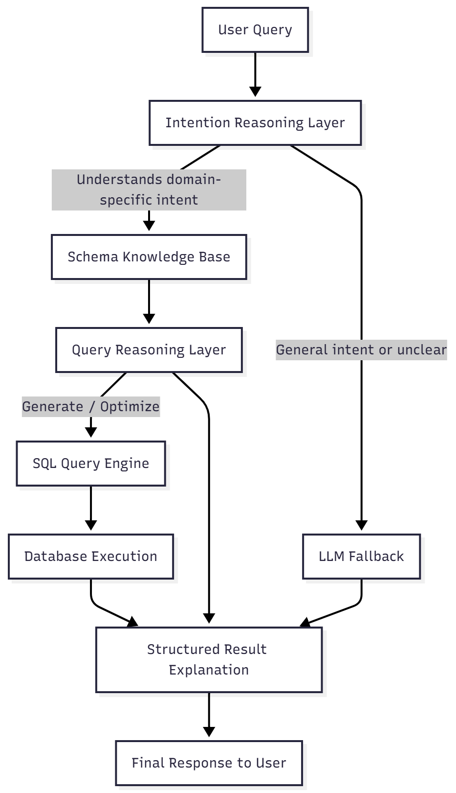

# Data Model Insight Accelerator

The **Data Model Insight Accelerator** is an intelligent query-generation and data-understanding framework that transforms natural-language questions into optimized database queries. It leverages schema-aware reasoning, multi-layered intent understanding, and LLM fallback to deliver accurate and meaningful insights from your database.

---

## Key Features

---

### 1. Schema Knowledge Base

- Stores database metadata (tables, columns, relationships, constraints).  
- Enhances contextual understanding and improves query accuracy.  
- Allows the system to reason using actual database structures instead of pure text predictions.  

---

### 2. Dual Reasoning Layers

#### a. Intent Reasoning Layer
Interprets what the user *means* and decides whether the request requires:

- SQL generation  
- Insight retrieval  
- Data explanation  
- LLM fallback for general or non-database questions  

#### b. Query Reasoning Layer

- Converts intent into structured query actions  
- Generates optimal SQL using schema information  
- Applies query optimization strategies  
- Ensures accuracy, correct joins, and valid filter logic  

---

### 3. LLM Fallback

If the user question is **too general**, **not database-specific**, or **non-technical**, the system delegates to an LLM to produce a helpful conversational response.

---

### 4. Execution + Post-Processing

- Executes the generated SQL on the database  
- Enhances results with explanations and human-readable insights  
- Returns a clean, structured final response to the user  

---

## How It Works

1. User asks a question (e.g., *“What are the top 5 customers by revenue?”*).  
2. **Intent Reasoning Layer** determines whether it is database-specific.  
3. The system queries the **Schema Knowledge Base** to understand tables and relationships.  
4. The **Query Reasoning Layer** generates and optimizes SQL.  
5. The SQL is executed on the target database.  
6. Results are enriched with insights and returned to the user.  
7. For general questions (e.g., *“Explain regression vs classification”*), the **LLM Fallback** generates the answer instead.

---


# Basic Flow Diagram


# How to run
keep your open ai key in the `.env` file inside `app/config`.

Then run this command from the project root:

```bash
uvicorn app.main:app --reload --host 0.0.0.0 --port 8000
```

Open `http://127.0.0.1:8000/docs` for the interactive FastAPI docs.

---

## AWS Lambda container deployment

This project now includes a Lambda-ready container entrypoint using `Mangum`.

### 1. Configure environment variables
Set these in the Lambda function configuration or in your IaC stack:

- `OPENAI_API_KEY`
- `TAVILY_API_KEY`
- `DB_HOST`, `DB_PORT`, `DB_NAME`, `DB_USER`, `DB_PASSWORD`
- `OAUTH_CLIENT_ID`, `OAUTH_CLIENT_SECRET`
- `ALLOWED_ORIGINS`
- `FASTAPI_ROOT_PATH` (optional, only if your API is mounted behind a stage path)

> Do not bake `app/config/.env` into the production image.

### 2. Build the container image locally

```bash
docker build -t dmia-lambda .
```

### 3. Test the Lambda container locally

```bash
docker run --rm -p 9000:8080 --env-file app/config/.env dmia-lambda
```

In another terminal:

```bash
curl http://localhost:9000/2015-03-31/functions/function/invocations \
  -d '{
    "version": "2.0",
    "routeKey": "GET /health",
    "rawPath": "/health",
    "rawQueryString": "",
    "headers": {"host": "localhost"},
    "requestContext": {"http": {"method": "GET", "path": "/health", "sourceIp": "127.0.0.1", "userAgent": "curl"}},
    "isBase64Encoded": false
  }'
```

### 4. Push to Amazon ECR and deploy to Lambda

```bash
aws ecr create-repository --repository-name dmia-lambda
aws ecr get-login-password --region <aws-region> \
  | docker login --username AWS --password-stdin <account-id>.dkr.ecr.<aws-region>.amazonaws.com

docker tag dmia-lambda:latest <account-id>.dkr.ecr.<aws-region>.amazonaws.com/dmia-lambda:latest
docker push <account-id>.dkr.ecr.<aws-region>.amazonaws.com/dmia-lambda:latest

aws lambda create-function \
  --function-name dmia-api \
  --package-type Image \
  --code ImageUri=<account-id>.dkr.ecr.<aws-region>.amazonaws.com/dmia-lambda:latest \
  --role <lambda-execution-role-arn> \
  --timeout 120 \
  --memory-size 1024
```
